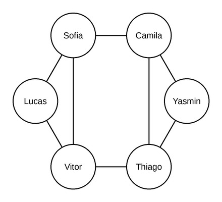
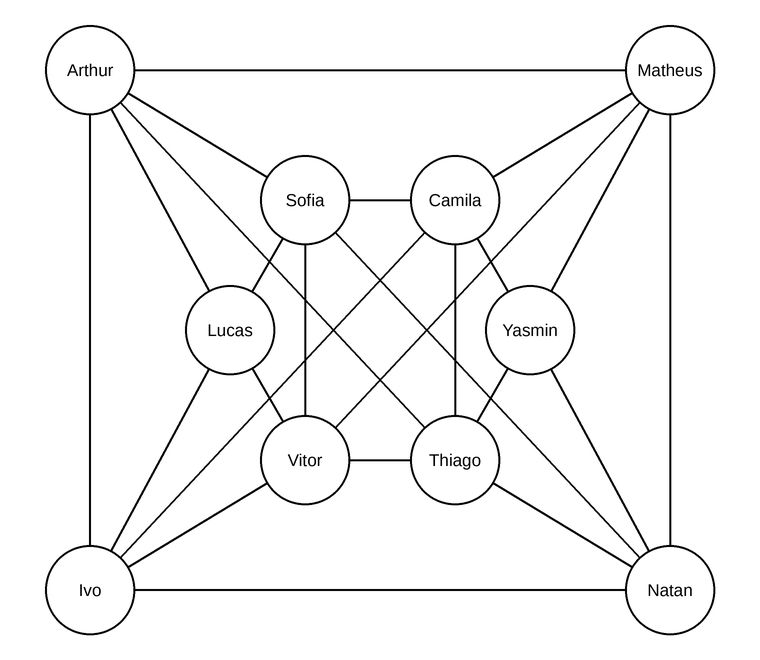

# ConectaUDF - Desafio em grupo

**Estrutura de Dados II**

**Grupo:** Arthur Arraes Antunes, Natan Adriel de Almeida Rodrigues, Matheus Enrico Corrêa Peters e Ivo Gustavo de Farias Barbosa

## Passo 1: Rede antes

A rede começa com 6 usuários e 8 amizades: Lucas, Sofia, Vitor, Camila, Thiago e Yasmin.



## Passo 2: Rede depois (com o grupo)

Entramos na rede nós 4 do grupo: Arthur, Natan, Matheus e Ivo. Cada um tem 5 amigos:

- Arthur: Lucas, Sofia, Thiago, Matheus e Ivo
- Matheus: Camila, Yasmin, Vitor, Arthur e Natan
- Natan: Yasmin, Thiago, Sofia, Matheus e Ivo
- Ivo: Vitor, Lucas, Camila, Arthur e Natan

Nós 4 ficamos ligados entre si (Arthur, Matheus, Natan, Ivo e de volta pro Arthur), o que fecha o grafo. Foram 16 amizades novas, então a rede ficou com 10 usuários e 24 amizades.



## Passo 3: Tabela de graus

| Usuário | Grau antes | Grau depois |
|---|---|---|
| Lucas | 2 | 4 |
| Sofia | 3 | 5 |
| Vitor | 3 | 5 |
| Camila | 3 | 5 |
| Thiago | 3 | 5 |
| Yasmin | 2 | 4 |
| Arthur | - | 5 |
| Matheus | - | 5 |
| Natan | - | 5 |
| Ivo | - | 5 |
| **Total** | **16** | **48** |

## Passo 4: Cálculos

Antes:

- V = 6
- E = 16 / 2 = 8
- D = 2 x 8 / (6 x 5) = 16 / 30 = 53,3%

Depois:

- V = 10
- E = 48 / 2 = 24
- D = 2 x 24 / (10 x 9) = 48 / 90 = 53,3%

Grau médio: antes 16 / 6 = 2,67 e depois 48 / 10 = 4,8.

A densidade ficou igual. O número de amizades triplicou (de 8 pra 24), mas o número de amizades possíveis também triplicou (de 15 pra 45), então a proporção não mudou.

## Passo 5: Caminhos

- Lucas até Yasmin: Lucas → Sofia → Camila → Yasmin (3 arestas). Continua com 3 mesmo depois que o grupo entrou.
- Arthur até Natan: Arthur → Sofia → Natan (2 arestas). Também dá por Matheus, Ivo ou Thiago.

## Passo 6: Código

```python
# Projeto ConectaUDF - Desafio em grupo
# Estrutura de Dados II
# Grupo: Arthur, Natan, Matheus e Ivo

from collections import deque

# Rede antes: 6 usuarios e 8 amizades
rede_antes = {
    "Lucas": ["Sofia", "Vitor"],
    "Sofia": ["Lucas", "Vitor", "Camila"],
    "Vitor": ["Lucas", "Sofia", "Thiago"],
    "Camila": ["Sofia", "Thiago", "Yasmin"],
    "Thiago": ["Vitor", "Camila", "Yasmin"],
    "Yasmin": ["Camila", "Thiago"]
}

# Rede depois: entram Arthur, Natan, Matheus e Ivo, cada um com 5 amigos
rede_depois = {
    "Lucas": ["Sofia", "Vitor", "Arthur", "Ivo"],
    "Sofia": ["Lucas", "Vitor", "Camila", "Arthur", "Natan"],
    "Vitor": ["Lucas", "Sofia", "Thiago", "Matheus", "Ivo"],
    "Camila": ["Sofia", "Thiago", "Yasmin", "Matheus", "Ivo"],
    "Thiago": ["Vitor", "Camila", "Yasmin", "Arthur", "Natan"],
    "Yasmin": ["Camila", "Thiago", "Matheus", "Natan"],
    "Arthur": ["Lucas", "Sofia", "Thiago", "Matheus", "Ivo"],
    "Matheus": ["Camila", "Yasmin", "Vitor", "Arthur", "Natan"],
    "Natan": ["Yasmin", "Thiago", "Sofia", "Matheus", "Ivo"],
    "Ivo": ["Vitor", "Lucas", "Camila", "Arthur", "Natan"]
}


def calcular(rede, nome):
    print("----", nome, "----")
    for usuario in rede:
        print(usuario, "- grau:", len(rede[usuario]))

    n = len(rede)
    soma_graus = sum(len(a) for a in rede.values())
    E = soma_graus // 2
    D = 2 * E / (n * (n - 1))

    print("Usuarios:", n)
    print("Soma dos graus:", soma_graus)
    print("Amizades:", E)
    print(f"Densidade: {D:.2%}")
    print()


# Busca em largura (BFS) para achar o menor caminho entre dois usuarios
def caminho(rede, inicio, fim):
    fila = deque([[inicio]])
    visitados = {inicio}
    while fila:
        atual = fila.popleft()
        if atual[-1] == fim:
            return atual
        for amigo in rede[atual[-1]]:
            if amigo not in visitados:
                visitados.add(amigo)
                fila.append(atual + [amigo])
    return None


calcular(rede_antes, "ANTES")
calcular(rede_depois, "DEPOIS")

print("Caminho Lucas -> Yasmin:", " -> ".join(caminho(rede_depois, "Lucas", "Yasmin")))
print("Caminho Arthur -> Natan:", " -> ".join(caminho(rede_depois, "Arthur", "Natan")))
```

Resultado:

```
---- ANTES ----
Lucas - grau: 2
Sofia - grau: 3
Vitor - grau: 3
Camila - grau: 3
Thiago - grau: 3
Yasmin - grau: 2
Usuarios: 6
Soma dos graus: 16
Amizades: 8
Densidade: 53.33%

---- DEPOIS ----
Lucas - grau: 4
Sofia - grau: 5
Vitor - grau: 5
Camila - grau: 5
Thiago - grau: 5
Yasmin - grau: 4
Arthur - grau: 5
Matheus - grau: 5
Natan - grau: 5
Ivo - grau: 5
Usuarios: 10
Soma dos graus: 48
Amizades: 24
Densidade: 53.33%

Caminho Lucas -> Yasmin: Lucas -> Sofia -> Camila -> Yasmin
Caminho Arthur -> Natan: Arthur -> Sofia -> Natan
```

## Perguntas

1. Quem é mais conectado? Isso significa que é o mais influente?

Oito usuários empatam com grau 5: Sofia, Vitor, Camila, Thiago e nós 4 do grupo. Mas ter mais amigos não quer dizer ser mais influente. O grupo, por exemplo, liga um lado da rede ao outro, então a informação passa mais rápido por nós do que só pelo grau dá pra ver.

2. Como sugerir amizade usando amigos em comum?

Olhando os amigos dos amigos. Arthur e Natan não são amigos, mas têm 4 amigos em comum (Sofia, Thiago, Matheus e Ivo), então a rede deveria sugerir um pro outro. Quanto mais amigos em comum, melhor a sugestão.

3. Que cuidados de privacidade são necessários?

Não mostrar a lista de amigos de ninguém sem permissão, deixar a pessoa escolher quem vê os dados dela e não usar essas informações pra outra coisa sem avisar, seguindo a LGPD.

4. Quais outras métricas podem descrever uma rede?

Grau médio, menor caminho entre dois usuários (que calculamos com BFS no código) e quantos grupos separados existem na rede.

## Conclusão

Antes a rede tinha 6 usuários, 8 amizades e densidade de 53,3%. Depois que o grupo entrou, ficou com 10 usuários, 24 amizades e a mesma densidade de 53,3%. O grau médio subiu de 2,67 pra 4,8, ou seja, cada pessoa ficou com mais amigos, mas a rede não ficou mais "cheia" proporcionalmente. Com o dicionário em Python foi fácil calcular os graus, as amizades, a densidade e até os caminhos com BFS.
