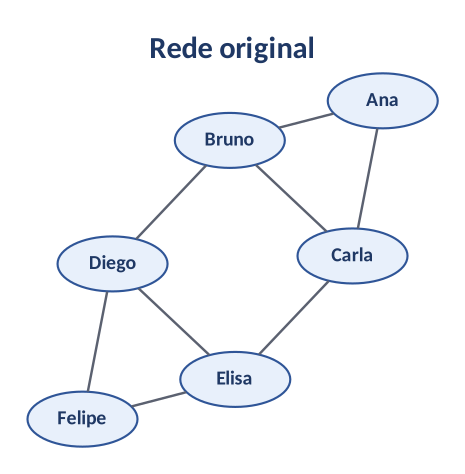
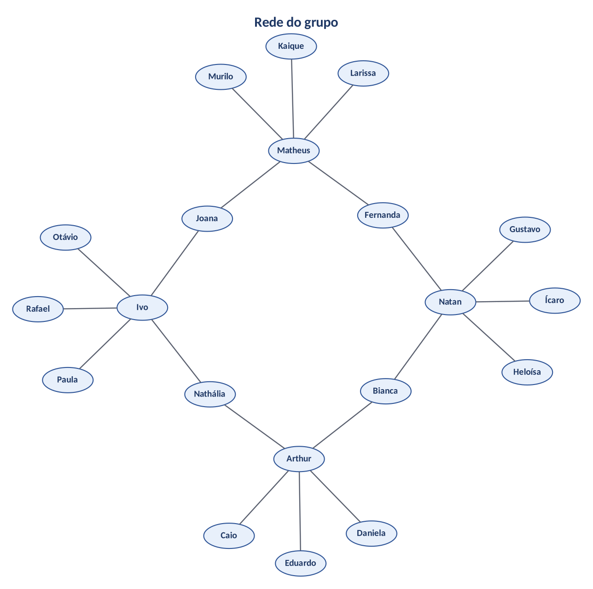

# ConectaUDF - Desafio em grupo

## Passo 1: Grafo original

6 usuários e 8 amizades.



## Passo 2: Rede do grupo

Fizemos uma rede nova só com os 4 integrantes do grupo. Cada um tem 5 amigos:

- Arthur: Bianca, Caio, Daniela, Eduardo e Nathália
- Natan: Bianca, Fernanda, Gustavo, Heloísa e Ícaro
- Matheus: Fernanda, Joana, Kaique, Larissa e Murilo
- Ivo: Joana, Nathália, Otávio, Paula e Rafael

Bianca, Fernanda, Joana e Nathália são amigas de dois integrantes, por isso a rede fica toda ligada. No total são 20 vértices (4 integrantes + 16 amigos).



## Passo 3: Tabela de graus

Rede original:

| Usuário | Grau |
|---|---|
| Ana | 2 |
| Bruno | 3 |
| Carla | 3 |
| Diego | 3 |
| Elisa | 3 |
| Felipe | 2 |
| Total | 16 |

Rede do grupo:

| Usuário | Grau |
|---|---|
| Arthur | 5 |
| Natan | 5 |
| Matheus | 5 |
| Ivo | 5 |
| Bianca | 2 |
| Fernanda | 2 |
| Joana | 2 |
| Nathália | 2 |
| Caio | 1 |
| Daniela | 1 |
| Eduardo | 1 |
| Gustavo | 1 |
| Heloísa | 1 |
| Ícaro | 1 |
| Kaique | 1 |
| Larissa | 1 |
| Murilo | 1 |
| Otávio | 1 |
| Paula | 1 |
| Rafael | 1 |
| Total | 40 |

## Passo 4: Cálculos

Rede original:
- V = 6
- E = 16 / 2 = 8
- D = 2 x 8 / (6 x 5) = 16 / 30 = 53,3%

Rede do grupo:
- V = 20
- E = 40 / 2 = 20
- D = 2 x 20 / (20 x 19) = 40 / 380 = 10,5%

A rede do grupo tem mais usuários e mais amizades, mas a densidade é bem menor (10,5% contra 53,3%). Isso acontece porque a maioria dos amigos conhece só um integrante, então quase todas as amizades possíveis não existem.

## Passo 5: Código

```python
# Projeto ConectaUDF - Desafio em grupo
# Estrutura de Dados II

# Rede original
rede_antes = {
    "Ana": ["Bruno", "Carla"],
    "Bruno": ["Ana", "Carla", "Diego"],
    "Carla": ["Ana", "Bruno", "Elisa"],
    "Diego": ["Bruno", "Elisa", "Felipe"],
    "Elisa": ["Carla", "Diego", "Felipe"],
    "Felipe": ["Diego", "Elisa"]
}

# Rede do grupo: Arthur, Natan, Matheus e Ivo, cada um com 5 amigos
rede_depois = {
    "Arthur": ["Bianca", "Caio", "Daniela", "Eduardo", "Nathalia"],
    "Natan": ["Bianca", "Fernanda", "Gustavo", "Heloisa", "Icaro"],
    "Matheus": ["Fernanda", "Joana", "Kaique", "Larissa", "Murilo"],
    "Ivo": ["Joana", "Nathalia", "Otavio", "Paula", "Rafael"],

    "Bianca": ["Arthur", "Natan"],
    "Fernanda": ["Natan", "Matheus"],
    "Joana": ["Matheus", "Ivo"],
    "Nathalia": ["Ivo", "Arthur"],

    "Caio": ["Arthur"],
    "Daniela": ["Arthur"],
    "Eduardo": ["Arthur"],
    "Gustavo": ["Natan"],
    "Heloisa": ["Natan"],
    "Icaro": ["Natan"],
    "Kaique": ["Matheus"],
    "Larissa": ["Matheus"],
    "Murilo": ["Matheus"],
    "Otavio": ["Ivo"],
    "Paula": ["Ivo"],
    "Rafael": ["Ivo"]
}


def calcular(rede, nome):
    print("----", nome, "----")
    for usuario in rede:
        print(usuario, "- grau:", len(rede[usuario]))

    n = len(rede)
    soma_graus = sum(len(a) for a in rede.values())
    E = soma_graus // 2
    D = 2 * E / (n * (n - 1))

    print("Usuarios:", n)
    print("Soma dos graus:", soma_graus)
    print("Amizades:", E)
    print(f"Densidade: {D:.2%}")
    print()


calcular(rede_antes, "ANTES")
calcular(rede_depois, "DEPOIS")
```

Resultado:

```
---- ANTES ----
Ana - grau: 2
Bruno - grau: 3
Carla - grau: 3
Diego - grau: 3
Elisa - grau: 3
Felipe - grau: 2
Usuarios: 6
Soma dos graus: 16
Amizades: 8
Densidade: 53.33%

---- DEPOIS ----
Arthur - grau: 5
Natan - grau: 5
Matheus - grau: 5
Ivo - grau: 5
Bianca - grau: 2
Fernanda - grau: 2
Joana - grau: 2
Nathalia - grau: 2
Caio - grau: 1
Daniela - grau: 1
Eduardo - grau: 1
Gustavo - grau: 1
Heloisa - grau: 1
Icaro - grau: 1
Kaique - grau: 1
Larissa - grau: 1
Murilo - grau: 1
Otavio - grau: 1
Paula - grau: 1
Rafael - grau: 1
Usuarios: 20
Soma dos graus: 40
Amizades: 20
Densidade: 10.53%
```

## Perguntas

1. Quem é mais conectado? Isso significa que é o mais influente?

Arthur, Natan, Matheus e Ivo, com grau 5. Mas ter mais amigos não quer dizer ser mais influente. Bianca, Fernanda, Joana e Nathália têm só 2 amigos, mas são elas que ligam um integrante ao outro.

2. Como sugerir amizade usando amigos em comum?

Vendo os amigos dos amigos. Arthur e Natan têm a Bianca como amiga em comum, então a rede pode sugerir o Natan para o Arthur. Quanto mais amigos em comum, melhor a sugestão.

3. Que cuidados de privacidade são necessários?

Não mostrar os amigos de alguém sem permissão e deixar a pessoa escolher quem vê os dados dela, seguindo a LGPD.

4. Quais outras métricas podem descrever uma rede?

Grau médio, menor distância entre dois usuários e quantos grupos separados existem.

## Conclusão

A rede original tem 6 usuários e 8 amizades, com densidade de 53,3%. A rede do grupo tem 20 usuários e 20 amizades, com densidade de 10,5%. Uma rede maior não fica necessariamente mais conectada. Com o dicionário em Python foi fácil calcular os graus, as amizades e a densidade.
